# 意図ルーティング（ローカル分類）要求仕様書

**親要求:** [index.md](../index.md) - REQ_005（AI対話）/ REQ_008（AI書き込みのレビュー可能性）

> **位置づけ:** 本 PRD は PoC（概念実証）である。本採用の可否は評価結果を見て判断し、必要なら ADR を起票する。

## 概要

ユーザーの自然言語入力を、LLM を呼ぶ前にブラウザ内のローカル分類器で「記録」「履歴参照」「アドバイス」「修正・削除」「その他」の意図に振り分ける。

狙いは次の3点。

1. **キーなしでも基本機能が動く**: 記録と履歴参照は LLM を使わずに完結させる。
2. **LLM 呼び出しを減らす**: アドバイスが必要なときだけ LLM を呼ぶ。
3. **確信度に応じた UI**: 確信度が低いときは推測で処理せず、候補チップでユーザーに選ばせる。

**セキュリティ制約（B-001 準拠）:** 推論はすべてブラウザ内で行い、入力テキストを外部の推論サービスに送らない。モデルファイルは同一オリジンの静的アセットとして配信する（FR_006）。

---

## 1. 意図クラスの定義

| ID | 意図 | 例 | ルーティング先 |
| --- | --- | --- | --- |
| `record` | 記録 | 「ベンチ60kgで10回3セット」「スクワット終わった、80kg×5」 | 数値抽出 → 種目照合 → セッション draft へ即時挿入（FR_004） |
| `history` | 履歴参照 | 「昨日ベンチ何kgだった？」「今月の脚の日いつ？」 | 端末内データ検索 → 表示 |
| `advice` | アドバイス | 「次は何kgにすべき？」「肩が痛いけどどうする？」 | LLM（キーがある場合のみ） |
| `edit` | 修正・削除 | 「さっきの記録70kgの間違い」「最後のセット消して」 | 対象記録の特定 → 通常カードへの誘導（FR_005） |
| `other` | その他 | 雑談、挨拶、無関係な入力 | 定型応答（キーがある場合は LLM も可） |

- **マルチラベル**として扱う。「60kgで10回やった、次どうすればいい？」は `record` + `advice`。この場合、先に記録を処理し、続けてアドバイスを LLM に回す。
- 意図定義の詳細（境界ケースの判定基準）は Phase 0 で作る意図定義ガイドラインを正とする。

## 2. 要求図（SysML Requirements Diagram）

```mermaid
requirementDiagram
    requirement IntentRouting {
        id: REQ_005
        text: "入力の意図をローカルで判定し処理を振り分ける"
        risk: medium
        verifymethod: test
    }

    functionalRequirement LocalClassification {
        id: FR_001
        text: "ブラウザ内で意図を較正済み確率付きで分類する（マルチラベル）"
        risk: medium
        verifymethod: test
    }

    functionalRequirement ConfidenceRouting {
        id: FR_002
        text: "確信度に応じて自動処理か候補チップ提示かを切り替える"
        risk: low
        verifymethod: test
    }

    functionalRequirement KeylessOperation {
        id: FR_003
        text: "APIキーなしで記録と履歴参照が完結する"
        risk: low
        verifymethod: demonstration
    }

    functionalRequirement RecordImmediateInsert {
        id: FR_004
        text: "record は確認カードを介さずセッション draft へ即時挿入する"
        risk: medium
        verifymethod: test
    }

    functionalRequirement EditGuidance {
        id: FR_005
        text: "edit は対象記録を特定し通常カードでの編集へ誘導する"
        risk: medium
        verifymethod: test
    }

    functionalRequirement ModelDelivery {
        id: FR_006
        text: "モデルは同一オリジン静的配信とし読み込み中は従来経路へフォールバックする"
        risk: medium
        verifymethod: test
    }

    functionalRequirement LocalFeedbackLog {
        id: FR_007
        text: "分類のフィードバックを端末内にのみ保存する"
        risk: low
        verifymethod: test
    }

    IntentRouting - contains -> LocalClassification
    IntentRouting - contains -> ConfidenceRouting
    IntentRouting - contains -> KeylessOperation
    IntentRouting - contains -> RecordImmediateInsert
    IntentRouting - contains -> EditGuidance
    IntentRouting - contains -> ModelDelivery
    IntentRouting - contains -> LocalFeedbackLog
```

## 3. 機能要求の詳細

### FR_001: ローカル意図分類

ユーザーの入力テキストをブラウザ内で分類し、意図ごとの較正済み確率を返す。分類器は `IntentClassifier` インターフェースの背後に置き、将来の差し替えを可能にする。ただし差し替え先はブラウザ内で完結するローカル分類器に限る。外部分類 API の利用は A-002（外部通信は Gemini API のみ）の例外承認（ADR によるアーキテクチャ例外）を前提とし、本 PRD の範囲では扱わない。入力テキストを外部の推論サービスへ送信しない（B-001）。

**検証方法:** テストによる検証

### FR_002: 確信度ルーティング

クラスごとに定めた閾値を超えた意図は自動でルーティングする。どの意図も閾値に達しない場合は推測で処理せず、候補チップ（「記録する」「履歴を見る」「アドバイスをもらう」等）を入力欄付近に表示してユーザーに選ばせる。`advice` と判定されても API キーが未設定なら LLM を呼ばず、設定画面への既存導線（api-key FR_010 / settings FR_022 の歯車バッジ、キー未設定バナー）を案内する。

**検証方法:** テストによる検証

### FR_003: キーなしでの完結

API キーが未設定でも、`record` と `history` は端末内で完結する。現行仕様ではキー未設定時にチャット入力が全面停止するが、本 PRD の範囲では分類器が確定した `record` / `history` に限りその停止を迂回する。`other` はキーなしでは定型応答のみとする。

**検証方法:** 実演による検証

### FR_004: record の即時挿入

`record` の処理結果は、per-write の確認カードを介さず、アクティブセッションの draft へ通常の種目カードとして即時挿入する。ユーザーは通常カード上で編集・削除でき、永続化はセッション終了時のみ行われる（REQ_008 / B-002 の現行解釈に整合）。

セッションが非アクティブな場合は記録を実行せず、既存のゲート（ai-chat FR_036 の `SESSION_NOT_ACTIVE` 相当の案内）に従う。

**検証方法:** テストによる検証

### FR_005: edit の対象特定と誘導

`edit` では対象の記録（セッション draft 内の種目・セット）を特定し、該当する通常カードへ誘導する。PoC の範囲では、プログラム経由で draft を書き換える新しい書き込み経路は作らない。対象を特定できない場合は候補チップで確認する。

ただし、対象を特定できず、かつ draft に種目が1件も無い場合は候補チップを提示できないため、例外として次のとおり扱う。API キーが設定されていれば、その入力を LLM へ委譲する（「種目マスターに追加して」のように分類器に該当クラスが無く、`edit` の処理では扱えない入力を LLM のツールで処理できる可能性があるため）。API キーが未設定の場合は、修正できる記録がまだセッションに無い旨の固定文言を返す。

**検証方法:** テストによる検証

### FR_006: モデルの配信とフォールバック

埋め込みモデルは ONNX（int8 量子化）として同一オリジンで静的配信し、初回のみダウンロードしてブラウザにキャッシュする。外部ホスティング（Hugging Face Hub 等）からの取得は A-002（外部通信は Gemini API のみ）に抵触するため採用しない。モデル読み込みが完了するまでの入力は、従来の入力経路（キーありなら LLM、なしなら現行の案内）で処理する。

**検証方法:** テストによる検証

### FR_007: 端末内フィードバックログ

ユーザーが候補チップで選んだ結果と、ルーティング後に取り消された操作を、端末内にのみ保存する。誤分類の分析と例文の追加に使う。外部へ送信しない（B-001）。

**検証方法:** テストによる検証

## 4. 既存仕様との関係

- **ai-chat FR_037 との役割分担**: ルーティング判定（どの処理に振り分けるか）はローカル分類器が担う。LLM は `advice` の内容生成と、分類器が確定できなかった入力の受け皿に専念する。ai-chat PRD 側にも FR_037 の役割分担として同内容を明記した（Phase 4）。ただし `edit` については、対象を特定できず draft も無い場合に限り LLM へ委譲する例外がある（FR_005）。
- **REQ_008 / B-002**: FR_004 のとおり、確認ゲートはセッション終了時であり、分類器の導入で per-write 確認は復活させない。
- **A-002**: FR_006 のとおり、モデルの外部配信は採用しない。

## 5. 評価指標と合格基準（仮）

PoC の合否は次の指標で判断する。基準値は Phase 1（ベースライン）の結果を見て見直す。

| 指標 | 内容 | 合格基準（仮） |
| --- | --- | --- |
| Macro-F1 | 全意図の平均 F1 | 0.90 以上 |
| 自動処理の正解率 | 閾値を超えて自動ルーティングした入力のうち正解の割合 | 95% 以上 |
| カバー率 | 自動ルーティングされた入力の割合（残りはチップ提示） | 80% 以上 |
| ECE | 確率の較正誤差 | 0.05 以下 |
| 推論レイテンシ | モデル読み込み後、中位スマホで1入力あたり | 100ms 以下 |
| ダウンロードサイズ | 量子化後のモデル合計 | 50MB 以下 |

## 6. 決定事項（旧・未決事項）

- モデルファイルの配置場所は `public/models/intent/` に確定した（Phase 4）。内訳は `config.json` / `tokenizer.json` / `tokenizer_config.json` / `classifier.json`（ヘッド重み・温度・閾値）/ `onnx/model_quantized.onnx`。再取得はブラウザの HTTP キャッシュに委ねる。
- `history` の結果表示は、現行のシンプルなテキスト表示に確定した（Phase 5）。専用表示 UI は作らない。
- 数値抽出（重量・回数・セット数）の範囲は次のとおり確定した（Phase 5、選択肢 C）。
  - ルールベース抽出は以下まで扱う: 定型パターン（「60kgで10回3セット」）、×表記（「80kg×5」「60kg 10回×3」）、時間（「プランク60秒」）、距離（「5kmラン」）、自重・回数のみ（「腕立て100回」）、「、」区切りの複数種目。
  - ルールで抽出できない場合のみ、API キーがある場合に限り LLM へ抽出を委譲する（従来の入力経路へフォールバック）。
  - キーがない場合はルールベースの範囲のみで処理し、抽出できなかった項目は空欄のまま draft カードへ即時挿入してユーザーが通常カードで埋める（FR_004 / B-002）。
  - 時間・距離の値は現行のセット形式（重量 × 回数）に保持する欄がないため、パターンとして認識し種目とセット数の抽出に用いるが、値そのものはセットに保持しない。抽出結果は確認メッセージにテキストで示し、該当セットは空欄として挿入する。

## 7. 実装状況と評価結果（Phase 4 時点）

- 採用モデル: Ruri-v3-30m + SetFit（train から 32 件/クラスで学習）。70m は Macro-F1 で上回ったが（0.977）、int8 量子化後も約 70MB と上限を超えるため見送った。
- 評価データ 205 件での実績（ONNX int8 化後のパイプラインで再現確認済み）:

| 指標 | 合格基準（仮） | 実績 |
| --- | --- | --- |
| Macro-F1 | 0.90 以上 | 0.953 |
| 自動処理の正解率 | 95% 以上 | 95.1% |
| カバー率 | 80% 以上 | 99.0% |
| ECE | 0.05 以下 | 0.022（較正後） |
| ダウンロードサイズ | 50MB 以下 | 37.1MB |

- 較正は温度スケーリング（クラス別温度を train の交差検証 OOF 確率で推定）。閾値はクラス別に record 0.30 / history 0.89 / advice 0.62 / edit 0.93 / other 0.30。
- 推論レイテンシは開発 VM の CPU で単文 5ms 程度を確認。中位スマホ実機での計測は本採用判断時に行う。
- ONNX Runtime の WASM 一式も同一オリジン（`public/ort/`）から配信し、transformers.js 既定の CDN 参照を使わない（A-002）。`@huggingface/transformers` の依存を更新する際は、内包する onnxruntime-web の dist から `public/ort/` へ再コピーする。

## 8. 実装状況（Phase 5: UI 統合）

- 送信パス（`useChatService`）に分類器を接続した。モデルの読み込みはバックグラウンドで行い、読み込み完了までは従来経路で処理する（FR_006）。分類が確定した入力はローカルで処理し、確定しなかった入力は候補チップで提示する（FR_002）。
- `record` はルールベース抽出（§6 の範囲）で draft へ即時挿入し、キーなしでも完結する（FR_003 / FR_004）。抽出できない場合はキーあり時のみ LLM 経路へ委譲する。
- `history` は端末内の過去セッションをローカル検索し、シンプルなテキストで返す。`advice` はキーなしでは設定画面への案内、キーありでは LLM。`other` はキーなしでは定型応答とする。
- `edit` は draft 内の対象種目を特定して通常カードへ誘導し、特定できない場合は候補チップで対象を選ばせる（FR_005）。フォローアップ（PR #149）で、対象を特定できず draft も無い場合はキーありなら LLM へ委譲し、キーなしなら固定文言を返す例外を追加した（FR_005）。
- 分類結果・候補チップでの選択・ルーティング後に取り消し／修正された記録は、端末内のフィードバックログ（localStorage）にのみ保存する（FR_007）。
